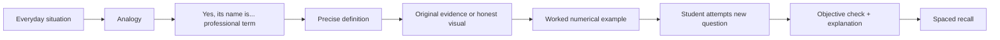

# SELF Career Prep — Phase 1 Quality Blueprint

> **Status:** Phase 1 specification, 22 October 2026. This is NOT a completed course, a third-party accreditation, or a job-offer guarantee.
> **Scope:** `ReyKylo/SELF` only. No Career UI redesign, no CV/Application mutation, no Supabase schema change in this phase.

## North star

Build a learner who can independently produce, explain, challenge and revise the underlying decision—not someone who merely reproduces a video or completes an attractive template.

**Recruiter-facing proof:** inspectable spreadsheet + cited assumptions + written decision + downside + independent defense. A 3-day sprint produces drafts, not automatic portfolio validation.

## Mandatory teaching language — analogy THEN the proper technical term

Every new concept must follow this order:



Example of the exact style (Indonesian, conversational but precise):

> 'Bayangin lu beli perusahaan Rp100 miliar. Rp40 miliar modal sendiri dan Rp60 miliar dana pinjaman. Keuntungan buat pemilik bisa naik kalau bisnis berkembang, tapi risiko juga makin tinggi karena kewajiban utang tetap harus dibayar.'
>
> **Yes, ini namanya leverage.** Kalau pembelian perusahaan memakai pendanaan utang signifikan, bentuk transaksinya adalah **Leveraged Buyout (LBO)**. Uang pemilik disebut **equity contribution**, dan pinjamannya disebut **debt financing**.
>
> **Definisi tepat:** LBO adalah transaksi akuisisi yang menggunakan porsi utang signifikan, dengan pelunasan umumnya diharapkan berasal dari arus kas target serta sumber lain yang tersedia. Ini bukan jaminan return membaik.

### Mini exercise: Sources & Uses

```text
                        ACQUISITION FUNDS — SIMULATED
  USES (money needed)                  SOURCES (money raised)
  Purchase price     Rp120 M           Acquisition debt    Rp60 M
  Transaction fees     Rp4 M           Sponsor equity      Rp64 M
  ---------------------------           ---------------------------
  Total Uses         Rp124 M           Total Sources     Rp124 M
                                 Funding Check: 124 - 124 = 0
```

**Ini namanya Sources & Uses of Funds.** Aturan modelnya `Total Sources = Total Uses`. Ini hanya contoh pembiayaan sederhana, bukan model transaksi sungguhan.

**Test new case:** Jika harga menjadi Rp130 M, fees Rp5 M, dan new debt Rp70 M, berapa sponsor equity yang harus disediakan?

**Answer key (for reviewer, hidden during test):** Rp65 M, karena `130 + 5 - 70 = 65`. Setelah itu tanyakan: *kenapa biaya transaksi mengurangi return investor sekalipun tidak mengubah harga bisnisnya?*

**Always name the term immediately after the analogy.** Avoid pseudo-synonyms: MOIC ≠ IRR; EBITDA ≠ Free Cash Flow; valuation ≠ proceeds; hypothesis ≠ verified root cause. Show where the analogy stops being accurate.

## Existing-build baseline (read-only audit)

| Area | Observed in main | Phase 1 quality gap |
|---|---|---|
| Sources | 41 catalog records | Mostly initial link/title checks, not a complete page/exhibit audit |
| Expert evidence | 12 panels; 7 external visual refs | External refs are not evidence of a rendered screenshot; 5 panels still lack previews |
| Videos | 11 | No complete skill→video→practice→review map |
| Portfolio training | 3 synthetic cases | Good foundations; no blind flagship work sample yet |
| Files and storage | Practice kit downloads + private portfolio upload | No verified uploaded-spreadsheet formula grader or expert feedback |
| Quality status | Self-reviewed checklist | Explicitly NOT an industry expert review or certificate |

## Professional benchmarks and honest source labels

**CFA Institute Private Equity Certificate:** three-statement/LBO modeling, debt/valuation, assessment and value creation. It informs PE competence targets; SELF is not CFA certified.

**Bessemer investment memos:** historical original investment decisions. Learn the structure and uncertainty in investor judgment, but never infer every VC firm uses exactly that template. In blind underwriting, freeze evidence to its contemporary date.

**McKinsey official cases:** problem structuring, evidence interpretation and recommendation. These are official interview practice cases, NOT publicly released confidential client deliverables.

**Learning science:** Dunlosky et al. (2013) supports *practice testing* and *distributed practice*; our chosen exact UX/rubric is a local design proposal, not validated by that research.

## Competency map — what a reviewer can actually inspect

All 36 skills require an observable work product and an explicit check. `foundation` means core initial capability, `advanced` signals additional complex work, `independent` is the blind/defense milestone.

### Private Equity & Buyout Investing — 12 competencies
**Core decision:** Would we acquire the company, at what maximum price, and under what conditions?

**Benchmark:** [CFA Institute Private Equity Certificate](https://www.cfainstitute.org/programs/private-equity-certificate); practitioner-informed learning outcomes, not SELF certification.

| Code | Demonstrated skill | Work product | Verification |
|---|---|---|---|
| PE-01 | Read IS, BS and CF and reconcile cash generation | Historical financial bridge with unit labels | EBITDA -> CFO -> cash available for debt; balance sheet matches |
| PE-02 | Distinguish EV and equity value | Bridge EV to equity with net debt and adjustments | Proceeds and enterprise value never conflated |
| PE-03 | Normalize earnings responsibly | EBITDA adjustment schedule with cited rationale | No unsupported add-backs or double counting |
| PE-04 | Design Sources & Uses | Funding schedule that balances | Total Sources minus Total Uses exactly zero |
| PE-05 | Build operating forecast and working capital | Linked cash flow schedules | Cash conversion, capex and working capital move with drivers |
| PE-06 | Model debt amortization, cash sweep and interest | Beginning debt, interest and ending debt each year | Debt roll-forward accurate; ending debt not negative |
| PE-07 | Compute sponsor MOIC and IRR | Equity cash flow and return schedule | Independent recalculation matches within chosen tolerance |
| PE-08 | Explain downside and multiple risk | 2D sensitivity / downside table | Entry and exit assumptions both auditable |
| PE-09 | Evaluate price versus return hurdle | Maximum bid calculation | Boundary price actually reproduces hurdle target |
| PE-10 | Assess credit and liquidity risk | Coverage, covenant and minimum cash considerations | No debt capacity recommendation ignoring downside liquidity |
| PE-11 | Write concise investment committee recommendation | Two-page IC memo with invest/pass/pricing/diligence | Model inputs cited and memo conclusion matches model |
| PE-12 | Defend live investment assumptions | Recorded or written rebuttal to challenge questions | Can explain 3 material sensitivities without solution aid |

### Venture Capital & Startup Underwriting — 12 competencies
**Core decision:** Invest, pass, or request diligence — at what terms and why?

**Benchmark:** [Bessemer public investment memos](https://www.bvp.com/memos/shopify); original historical investor-authored evidence, not a standard all VCs adopt.

| Code | Demonstrated skill | Work product | Verification |
|---|---|---|---|
| VC-01 | Distinguish problem, target customer and market | Customer/problem evidence map | TAM top-down does not masquerade as achievable revenue |
| VC-02 | Judge founder-market fit without invented claims | Evidence/unknown table and founder questions | No unsupported biographical assertions |
| VC-03 | Compute consistent SaaS revenue measures | MRR/ARR bridge by month | Recurring and non-recurring cash receipts separate |
| VC-04 | Analyze same-age cohorts | Cohort retention sheet | Month-3 and month-6 cohorts not directly treated as same-age |
| VC-05 | Calculate gross/net retention | Logo retention, GRR, NRR calculations | Denominator, expansion and churn treatment explicit |
| VC-06 | Calculate CAC and gross-profit payback | CAC schedule with acquisition spend | Payback uses gross profit not raw revenue |
| VC-07 | Understand burn and runway | Net burn and liquidity schedule | Cash balance divided by disclosed net burn; scenario tested |
| VC-08 | Model pre/post money, cap table and dilution | Round closing and subsequent dilution schedule | Ownership sums to 100%, entries reconcile |
| VC-09 | Translate stake to fund returns | Investor proceeds and scenario MOIC | No confusion between startup valuation and fund IRR |
| VC-10 | Challenge market, competitive and execution assumptions | Risks with falsifiable diligence requests | 3 measurable investment gates |
| VC-11 | Write concise VC partner memo | Two-page invest/pass/further diligence memo | Decision supported by metric provenance |
| VC-12 | Defend investment under uncertainty and historical context | Blind decision + later outcome comparison | No hindsight leakage in original underwriting |

### Strategy Consulting & Executive Problem Solving — 12 competencies
**Core decision:** What should management do, why, at what impact, and with which tradeoffs?

**Benchmark:** [McKinsey official case interview practice](https://www.mckinsey.com/careers/interviewing); recruitment practice case, not proof of real client project.

| Code | Demonstrated skill | Work product | Verification |
|---|---|---|---|
| CO-01 | Clarify client objective and decision criterion | One-sentence decision statement | Clear objective, timeframe and constraints |
| CO-02 | Structure a custom issue tree | MECE-enough, hypothesis-driven issue tree | Branches relevant to case, no generic framework dumping |
| CO-03 | Calculate driver based market sizing | Market size with unit conversions | Denominator and reachable share separated |
| CO-04 | Build profitability bridge | Revenue-volume-price-cost driver sheet | Bridge reconciles to reported profit movement |
| CO-05 | Separate observed effects from causal hypotheses | Evidence vs hypothesis log | No root cause asserted from arithmetic alone |
| CO-06 | Quantify incremental initiatives | Initiative impact, cost and payback | Baseline/incremental calculations consistent |
| CO-07 | Account for overlapping benefits | Combined initiative reconciliation | No double counting shared impact |
| CO-08 | Evaluate tradeoffs and execution risks | Alternatives ranking with constraints | Not merely pick highest gross benefit |
| CO-09 | Turn analysis into CEO storyline | Six-slide action-title deck | Every title is a conclusion supported by exhibit |
| CO-10 | Set actionable 90-day roadmap | Milestone/owner/KPI plan | Metrics have owner, timing and stop/scale gate |
| CO-11 | Make explicit recommendation and decision ask | Executive summary with quantified impact | Client can see exactly what must be approved |
| CO-12 | Defend conclusion with case-specific reasoning | Cold case + follow-up challenge | Responds to objections without canned frameworks |

## Rubric for an independent case (SELF-internal, NOT a hiring-firm rubric)

| Dimension | Weight |
|---|---:|
| technical — Model / numeric integrity, checks and formula logic | 30% |
| judgment — Defensible business decision, alternatives and tradeoffs | 25% |
| evidence — Data provenance, disclosure and assumptions | 20% |
| risk — Downside, sensitivities and falsifiable risks | 15% |
| communication — Executive clarity, traceability, concise action-oriented output | 10% |

**Proposed portfolio-candidate threshold:** 80/100 overall, technical ≥24/30, evidence ≥14/20, all critical checks verified, independent case attempted, credible defense, and manual validation. **Thresholds are proposed, not psychometrically validated.**

### Hard stops (a high numerical score cannot override these)

Unverifiable original evidence, fabricated or misattributed screenshot, calculation model that does not reconcile, source misrepresentation, missing downside when risk is central, private work exposed to other users, broken real file/download, full answer key visible during blind test, or false 'expert approved' claim.

### Separate what can and cannot be mechanically scored

| Checker | Can verify | Must not claim |
|---|---|---|
| Deterministic computation | Numerically consistent and parsed formulas, exact target outputs, invariant and file CRC/checksum | Whether investment thesis is wise |
| AI coaching | Reasoning critique with cited snippets and assumptions | Guaranteed objective grade, human endorsement, complete XLSX check without parsed cells |
| Self-attestation | User confirms having reviewed a checklist | Independent reviewer approval |
| Named human reviewer | Explicitly inspected work within recorded scope | Entire hiring firm endorsement without permission |

## Requirements of a *real* case packet

| Training case | Independent/recruiter-facing case |
|---|---|
| Synthetic data and sealed numerical answer | Timestamped public primary sources and precise page references |
| Guided example after user attempt | New dataset; no complete prior walkthrough |
| Working and blank workbooks separated | Assumption register with fact/hypothesis/hypothetical distinction |
| Known financial invariants, at least 4 distinct exhibits | Reproducible model + scenario + evidence log |
| Clear prompt and 3 adversarial review questions | Written recommendation, counterarguments, revision history |
| Practice version labeled SIMULATED | Work sample labeled INDEPENDENT, not executed transaction or client mandate |

### Concrete case acceptance tests

**PE:** Sources = Uses; ending debt roll-forward; tax, interest, working capital, EBITDA/cash all reconcile; MOIC/IRR independently verified; exit multiple downside and maximum price. A solved case without these cannot pass.

**VC:** same-age cohorts; GRR/NRR numerators/denominators; CAC payback on gross profit; pre/post-money and dilution ownership sums reconcile; runway and downside; investment memo contains go/no-go/diligence gates.

**Consulting:** prior-to-current profit bridge reconciles; initiative A/B and interactions not double-counted; every deck slide has an actionable headline supported by one exhibit; 90-day roadmap has owner/KPI/kill criteria.

## Source, copyright and provenance discipline

Each evidence entry must retain publisher, canonical URL, original publication or cutoff date, exact page/section, preview access state, rights status, and a *claim vs original exhibit* cross-check. Never turn a stock/mock image into 'authentic'. If image embed is restricted, provide a precise source pointer and disclose limitation.

## Release plan and QA ownership

| Gate | Deliverable | Evidence of pass |
|---|---|---|
| G1_CONTENT | Case consistency and provenance | No unlabelled unsupported figures and no unresolved arithmetic invariant |
| G2_TEACH | Analogy + term + transfer | All teaching steps occur in order; naming rule always clear; analogies do not distort definitions |
| G3_EVIDENCE | Source to exhibit mapping | All used claims grounded; missing preview honestly marked |
| G4_TECH | Deterministic formula QA | Deliberately altered formula flagged; no assertion of checking unparsed XLSX |
| G5_DECISION | Blind independent assessment | Assessment is not coached, answer leakage or unsupported automatic pass |
| G6_PORTFOLIO | Recruiter-facing artifact review | No fake credentials, defensible scope, files open and explainable |
| G7_PRODUCTION | Security/runtime/UX | No unrelated regressions and no unverified live claims |

Phase 1 is a **specification-only** milestone. It is finished when the competency and quality contract is versioned, mechanically linted, reviewed, and placed in the repository. It does **not** require shipping a new course UI. Phase 2 is authorized only after this is approved as design/input.

## Phase 2 handoff — first flagship PE case

Build a cohesive PE case packet with an original company story, financial statements for at least 3 historical years if source permits, revenue/EBITDA/cash conversion conflict, transaction financing, debt covenants, forecasting drivers, management-versus-investor assumptions, downside, decision gates, and a complete answer/reconciliation set.

**This does not license inventing real audited financial statements.** If we cannot verify filings, use clearly simulated documents and leave live-source claims out.

## Primary source list

- [CFA Private Equity Certificate](https://www.cfainstitute.org/programs/private-equity-certificate) — 3-statement modeling, LBO, deal/risk and value creation training
- [Bessemer original Shopify Investment Memo](https://www.bvp.com/memos/shopify) — Original public investor-author memo; a historical example rather than universal standard
- [McKinsey official interviewing overview](https://www.mckinsey.com/careers/interviewing) — Problem-solving, sample cases and articulation of recommendations
- [Dunlosky et al. 2013 evidence review](https://doi.org/10.1177/1529100612453266) — Practice testing and distributed practice high-utility learning techniques

## Implementation integrity

Use `content/career-prep-quality-blueprint.json` as the machine-readable contract for Phase 2–7 content. Do not replace the existing content file or existing fields. Protect Career CVs, Applications, My Work, Interview Prep, Opportunity Radar and all other SELF modules; changes to them require separate requirements and regression tests.

**Live deployment is not validated by a documentation PR or passing GitHub CI.**
